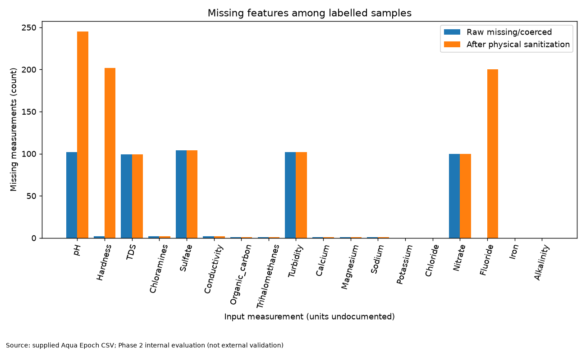
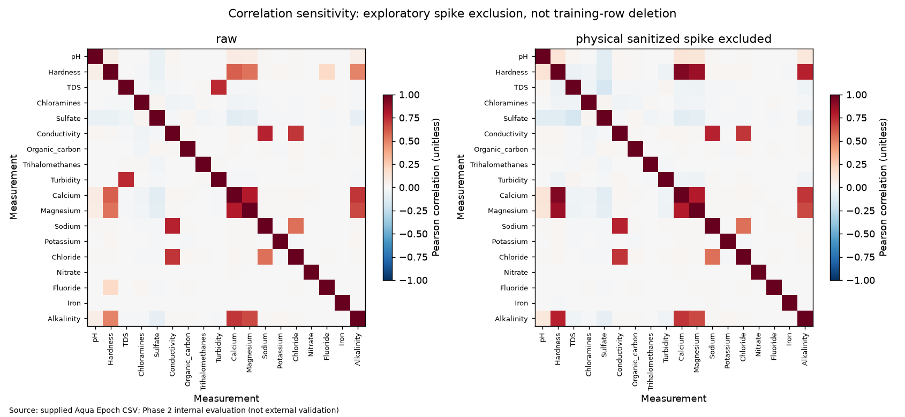
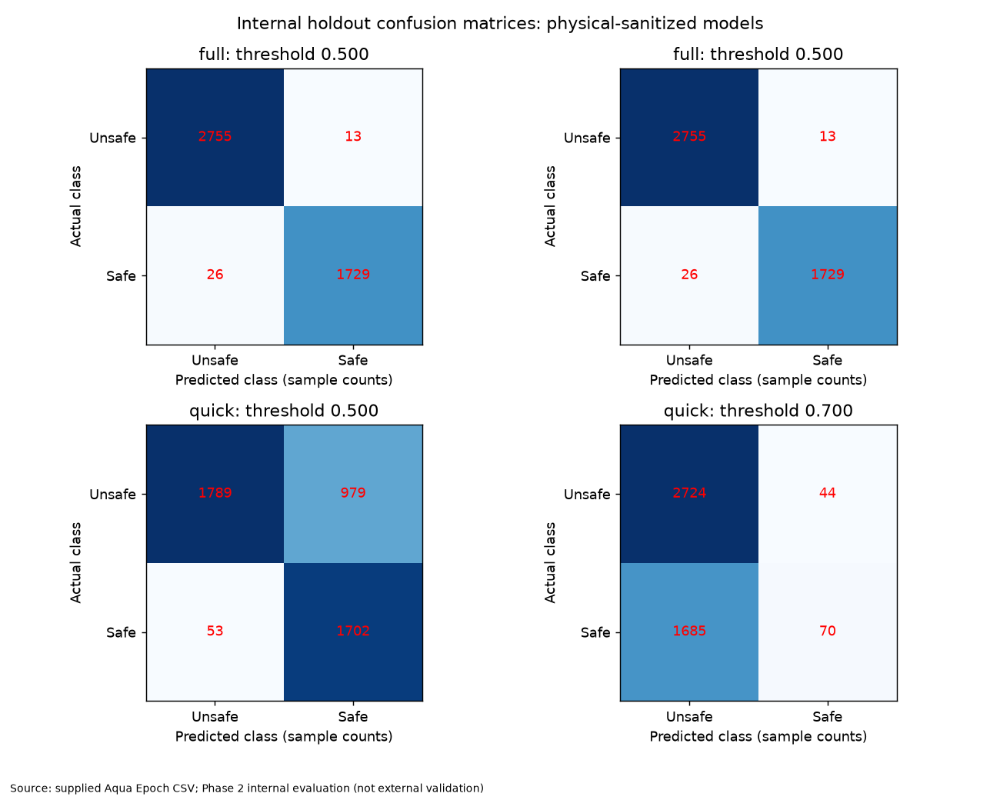
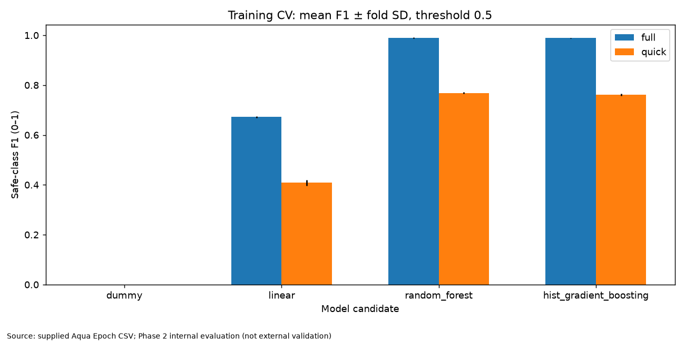
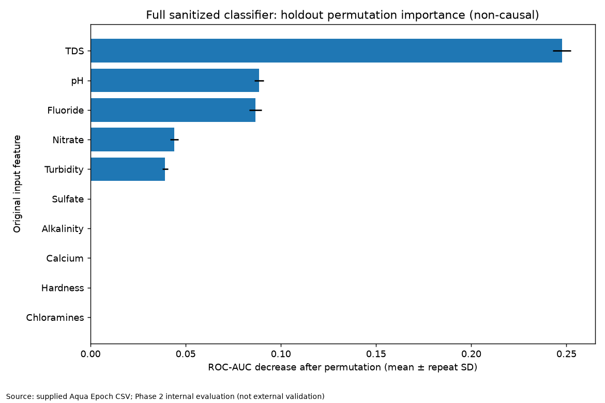
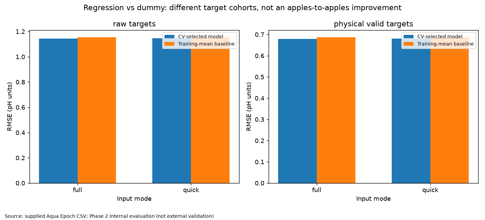

# Phase 2 — internal model validation

Experimental evidence only. No Phase 1/backend models were replaced. This is not a drinking-water certification.

## Data and protocol

- Source SHA-256: `f536b0e324783a187c20df684661bc68ef024b8994144db0e10e3f8e55640bbf`.
- Raw rows: 26500; labelled: 22611; blank: 3888; nonblank unlabelled: 1.
- All four model candidates are compared only on training folds. Median imputation/scaling is fit separately within each fold.
- Winner and dummy are evaluated on a 20% internal holdout. The dataset was explored in Phase 1; this is not a pristine external test.
- Policies and target cohorts are reported separately, never chosen using holdout scores.
- Exact duplicate/conflict checks do not rule out near-duplicate augmentation or common source samples. No source IDs are supplied by organisers.
- Classification: positive class is safe (1). FPR means actual unsafe water predicted safe.
- Safety-oriented threshold stays >=0.5 and is selected from training OOF probabilities for empirical FPR <=2%. Holdout FPR may exceed this cap.
- Probabilities are not claimed calibrated; Brier scores and Wilson FPR intervals are reported.
- OOF candidate selection and threshold selection are not nested. Repeated/block splits reuse dataset rows and primary-selected configuration; they are sensitivity checks, not independent validation.
- Units remain undocumented. Negative concentrations become missing only under the explicit sanitized policy. Positive spikes and pH=0.2 are retained.

## Data findings

- 143 observed pH values fall outside operational [0,14]; 102 pH targets are missing.
- 200 rows contain both negative hardness and negative fluoride.
- TDS/Turbidity Pearson correlation, raw: 0.74257.
- TDS/Turbidity Pearson correlation, physical_sanitized: 0.74257.
- TDS/Turbidity Pearson correlation, spike_excluded: 0.02772.
- TDS/Turbidity Pearson correlation, physical_sanitized_spike_excluded: 0.02772.

## Results by predeclared policy and cohort

### classification_binary_targets_full_raw

- CV-selected model: **hist_gradient_boosting**; CV f1: 0.98790 ± 0.00157 (fold SD).
- baseline_threshold_0_5: threshold 0.50000; F1 0.98830; AUC 0.99976; unsafe→safe FPR 0.65% (Wilson 0.41%–1.03%); safe precision 98.97%; safe recall 98.69%; safe-call coverage 38.69%.
- conservative_threshold: threshold 0.50000; F1 0.98830; AUC 0.99976; unsafe→safe FPR 0.65% (Wilson 0.41%–1.03%); safe precision 98.97%; safe recall 98.69%; safe-call coverage 38.69%.
- Stress source_order, safety operating point: F1 0.98648, FPR 0.69%.
- Stress seed_7, safety operating point: F1 0.98976, FPR 0.76%.
- Stress seed_91, safety operating point: F1 0.99035, FPR 0.83%.

### classification_binary_targets_full_physical_sanitized

- CV-selected model: **random_forest**; CV f1: 0.99004 ± 0.00216 (fold SD).
- baseline_threshold_0_5: threshold 0.50000; F1 0.98885; AUC 0.99969; unsafe→safe FPR 0.47% (Wilson 0.27%–0.80%); safe precision 99.25%; safe recall 98.52%; safe-call coverage 38.51%.
- conservative_threshold: threshold 0.50000; F1 0.98885; AUC 0.99969; unsafe→safe FPR 0.47% (Wilson 0.27%–0.80%); safe precision 99.25%; safe recall 98.52%; safe-call coverage 38.51%.
- Stress source_order, safety operating point: F1 0.99073, FPR 0.58%.
- Stress seed_7, safety operating point: F1 0.99372, FPR 0.25%.
- Stress seed_91, safety operating point: F1 0.99060, FPR 0.58%.

### classification_binary_targets_quick_raw

- CV-selected model: **random_forest**; CV f1: 0.76790 ± 0.00401 (fold SD).
- baseline_threshold_0_5: threshold 0.50000; F1 0.76795; AUC 0.81574; unsafe→safe FPR 35.19% (Wilson 33.43%–36.99%); safe precision 63.59%; safe recall 96.92%; safe-call coverage 59.14%.
- conservative_threshold: threshold 0.69477; F1 0.04803; AUC 0.81574; unsafe→safe FPR 1.19% (Wilson 0.85%–1.67%); safe precision 57.14%; safe recall 2.51%; safe-call coverage 1.70%.
- Stress source_order, safety operating point: F1 0.05791, FPR 1.13%.
- Stress seed_7, safety operating point: F1 0.03982, FPR 0.61%.
- Stress seed_91, safety operating point: F1 0.05217, FPR 1.34%.

### classification_binary_targets_quick_physical_sanitized

- CV-selected model: **random_forest**; CV f1: 0.76866 ± 0.00378 (fold SD).
- baseline_threshold_0_5: threshold 0.50000; F1 0.76736; AUC 0.81861; unsafe→safe FPR 35.37% (Wilson 33.61%–37.17%); safe precision 63.48%; safe recall 96.98%; safe-call coverage 59.27%.
- conservative_threshold: threshold 0.70039; F1 0.07491; AUC 0.81861; unsafe→safe FPR 1.59% (Wilson 1.19%–2.13%); safe precision 61.40%; safe recall 3.99%; safe-call coverage 2.52%.
- Stress source_order, safety operating point: F1 0.08368, FPR 1.90%.
- Stress seed_7, safety operating point: F1 0.05882, FPR 0.98%.
- Stress seed_91, safety operating point: F1 0.06233, FPR 1.73%.

### regression_raw_targets_full_raw

- CV-selected model: **linear**; CV rmse: 1.10047 ± 0.03104 (fold SD).
- Internal holdout: RMSE 1.14616, MAE 0.56647, R² 0.01284.
- Dummy RMSE 1.15361; relative RMSE reduction 0.65%. A small gain is not strong predictability.
- Stress source_order: RMSE 1.05324, skill vs dummy 0.63%.
- Stress seed_7: RMSE 1.12168, skill vs dummy 0.35%.
- Stress seed_91: RMSE 1.10784, skill vs dummy 0.47%.

### regression_raw_targets_full_physical_sanitized

- CV-selected model: **linear**; CV rmse: 1.10006 ± 0.03123 (fold SD).
- Internal holdout: RMSE 1.14471, MAE 0.56538, R² 0.01533.
- Dummy RMSE 1.15361; relative RMSE reduction 0.77%. A small gain is not strong predictability.
- Stress source_order: RMSE 1.05224, skill vs dummy 0.73%.
- Stress seed_7: RMSE 1.12097, skill vs dummy 0.41%.
- Stress seed_91: RMSE 1.10804, skill vs dummy 0.45%.

### regression_raw_targets_quick_raw

- CV-selected model: **linear**; CV rmse: 1.10324 ± 0.03077 (fold SD).
- Internal holdout: RMSE 1.15048, MAE 0.57177, R² 0.00539.
- Dummy RMSE 1.15361; relative RMSE reduction 0.27%. A small gain is not strong predictability.
- Stress source_order: RMSE 1.05758, skill vs dummy 0.22%.
- Stress seed_7: RMSE 1.12438, skill vs dummy 0.11%.
- Stress seed_91: RMSE 1.11129, skill vs dummy 0.16%.

### regression_raw_targets_quick_physical_sanitized

- CV-selected model: **linear**; CV rmse: 1.10116 ± 0.03079 (fold SD).
- Internal holdout: RMSE 1.14682, MAE 0.56779, R² 0.01170.
- Dummy RMSE 1.15361; relative RMSE reduction 0.59%. A small gain is not strong predictability.
- Stress source_order: RMSE 1.05509, skill vs dummy 0.46%.
- Stress seed_7: RMSE 1.12225, skill vs dummy 0.30%.
- Stress seed_91: RMSE 1.10889, skill vs dummy 0.38%.

### regression_physical_valid_targets_full_raw

- CV-selected model: **linear**; CV rmse: 0.69146 ± 0.03126 (fold SD).
- Internal holdout: RMSE 0.67843, MAE 0.49817, R² 0.02330.
- Dummy RMSE 0.68649; relative RMSE reduction 1.17%. A small gain is not strong predictability.
- Stress source_order: RMSE 0.67797, skill vs dummy 1.40%.
- Stress seed_7: RMSE 0.66297, skill vs dummy 1.60%.
- Stress seed_91: RMSE 0.66450, skill vs dummy 0.99%.

### regression_physical_valid_targets_full_physical_sanitized

- CV-selected model: **linear**; CV rmse: 0.69079 ± 0.03122 (fold SD).
- Internal holdout: RMSE 0.67838, MAE 0.49796, R² 0.02347.
- Dummy RMSE 0.68649; relative RMSE reduction 1.18%. A small gain is not strong predictability.
- Stress source_order: RMSE 0.67749, skill vs dummy 1.47%.
- Stress seed_7: RMSE 0.66225, skill vs dummy 1.70%.
- Stress seed_91: RMSE 0.66405, skill vs dummy 1.05%.

### regression_physical_valid_targets_quick_raw

- CV-selected model: **hist_gradient_boosting**; CV rmse: 0.69706 ± 0.03120 (fold SD).
- Internal holdout: RMSE 0.68298, MAE 0.50132, R² 0.01016.
- Dummy RMSE 0.68649; relative RMSE reduction 0.51%. A small gain is not strong predictability.
- Stress source_order: RMSE 0.68261, skill vs dummy 0.73%.
- Stress seed_7: RMSE 0.66874, skill vs dummy 0.74%.
- Stress seed_91: RMSE 0.66808, skill vs dummy 0.45%.

### regression_physical_valid_targets_quick_physical_sanitized

- CV-selected model: **linear**; CV rmse: 0.69343 ± 0.03121 (fold SD).
- Internal holdout: RMSE 0.68119, MAE 0.50014, R² 0.01534.
- Dummy RMSE 0.68649; relative RMSE reduction 0.77%. A small gain is not strong predictability.
- Stress source_order: RMSE 0.68037, skill vs dummy 1.05%.
- Stress seed_7: RMSE 0.66590, skill vs dummy 1.16%.
- Stress seed_91: RMSE 0.66666, skill vs dummy 0.66%.

## Interpretation and promotion gate

- High classification scores describe reproduction of supplied labels, not microbiological safety or BIS compliance.
- FPR reduction can sacrifice almost all safe recall in quick mode. Low FPR alone must not be sold as a useful or trustworthy safe-water detector; inspect safe precision and coverage too.
- A lower pH RMSE after removing invalid targets reflects a different evaluation cohort. Keep raw-target scores alongside it.
- Do not use Potability to predict pH, fabricate improved targets, or hide bad predictions by clipping test labels.
- Phase 3 should explicitly choose and validate deployment policy, handle uncertain/out-of-distribution inputs, and integrate thresholds/feature names with backend before promotion.
- Existing backend loads Phase 1 models and has NOT been changed by this evaluation.

## Reproducibility

See runtime_config.json for exact versions and arguments, split_indices.json for original source row indices (CSV line=index+2), comparison.csv for all CV candidates, and results.json for full evidence.
Candidate joblib files require this project's ml.quality module. Only load files you generated/trust; joblib can execute code.

## Figures

